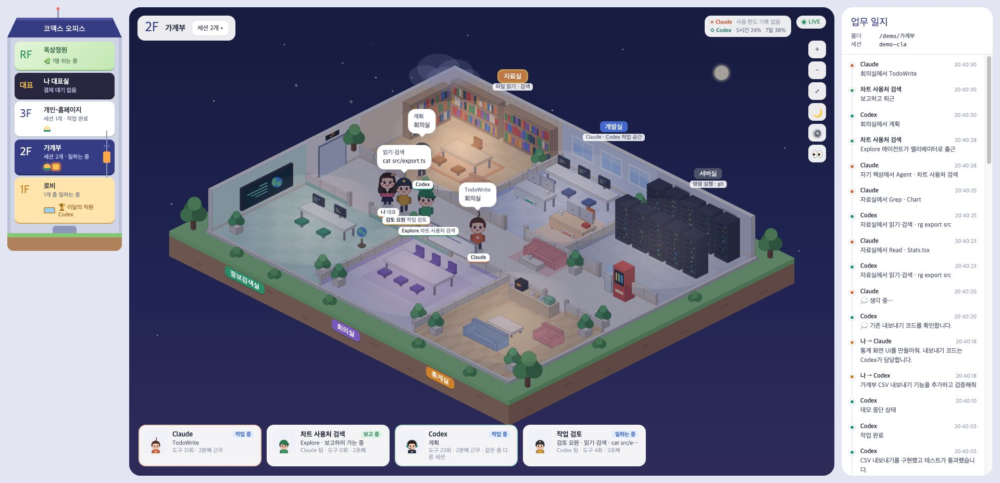
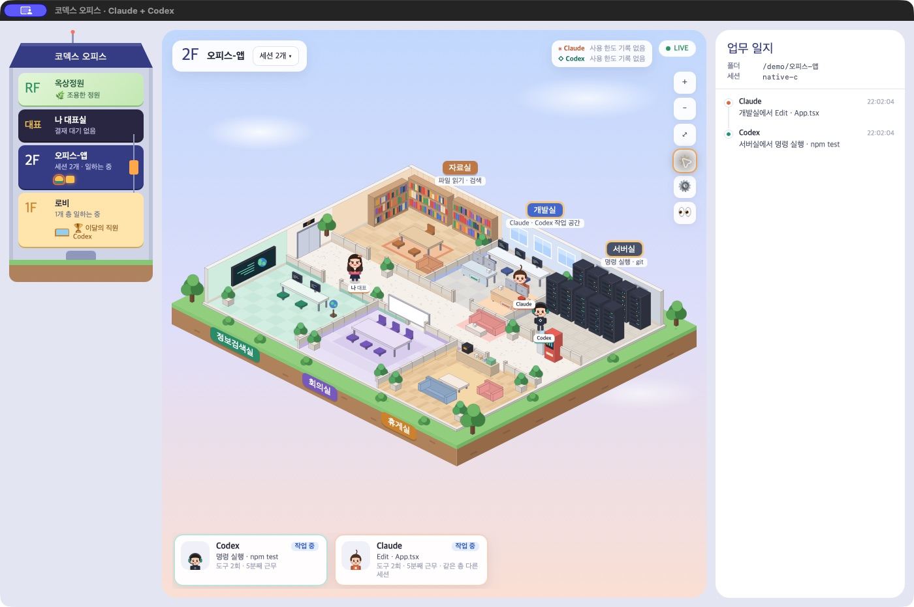

# 코덱스 오피스

Claude Code와 Codex의 로컬 세션 기록을 **읽기만** 하여 기존 미니어처 사무실 화면에 표시합니다.
TOPLAIN SOFT의 [claude-office](https://github.com/toplainsoft/claude-office), commit `3c3d110ed2d398a745acfa76550c2dab993647e3`를 바탕으로 Codex 기록 해석을 보완하고 양쪽 도구를 함께 지원하도록 만든 수정판입니다. 원본 화면과 MIT 라이선스를 유지합니다.



위 이미지는 가짜 작업 기록으로 실행한 데모입니다.

## 원작과 수정 범위

- **원작자:** TOPLAIN SOFT
- **원본 저장소:** https://github.com/toplainsoft/claude-office
- **기준 버전:** [3c3d110](https://github.com/toplainsoft/claude-office/tree/3c3d110ed2d398a745acfa76550c2dab993647e3)
- **원본 라이선스:** MIT — 저작권 및 허가 고지를 [LICENSE](LICENSE)에 그대로 보존했습니다.
- **이 저장소의 변경:** 원본 사무실 화면을 유지하면서 Claude·Codex별 기록 해석기, 상태 전이, 읽기 전용 모니터, 사용량 표시, 데모와 회귀 테스트를 구현했습니다. 외부 폰트 요청과 Claude 설정 변경 기능을 제거하고 좁은 화면의 배치를 보완했습니다.

자세한 출처는 [THIRD_PARTY_NOTICES.md](THIRD_PARTY_NOTICES.md)에 있습니다.

매일 실행하는 순서와 양쪽 도구를 함께 사용하는 방법은 **[사용 가이드](USAGE.md)** 에 정리했습니다.

## Mac 앱으로 실행

**[CodexOffice.app.zip 다운로드](docs/CodexOffice.app.zip)** → 압축 해제 → 응용 프로그램 폴더에 옮기기 → 앱 더블클릭.

앱이 서버와 전용 창을 함께 열고, 창을 닫으면 서버도 종료합니다. Node.js 18 이상은 설치되어 있어야 하며 터미널·별도 브라우저는 필요 없습니다. macOS 13 이상, Apple Silicon/Intel Universal 빌드입니다.

[앱 설치·종료·업데이트와 빌드 안내](docs/MAC_APP.md)



## 터미널에서 실행

Node.js **18 이상**이 필요합니다. 추가 패키지 설치, API 키, 모델 설정은 필요 없습니다.

```sh
git clone https://github.com/prestige-kim/codex-office.git
cd codex-office
npm start
```

이미 내려받은 폴더가 있다면 그 폴더에서 `npm start`만 실행합니다. 비공개 저장소를 복제할 때는 접근 권한이 있는 GitHub 계정으로 인증되어 있어야 합니다.

브라우저에서 **http://localhost:4777** 을 엽니다. Mac에서는 `오피스 실행.command`를 실행해도 됩니다. 실행 중인 터미널에서 `Ctrl+C`로 종료합니다. 프로그램은 브라우저를 자동으로 열지 않습니다.

Claude Code와 Codex 앱·CLI에서 평소처럼 작업하면 프로젝트별 층과 세션이 표시됩니다. 설정 버튼에서 건물 이름과 대표 이름을 바꿀 수 있습니다. 세션을 누르면 그 세션의 사무실을 봅니다. 같은 작업 폴더는 한 층에 표시됩니다. 화면은 작업을 지시하거나 승인하지 않습니다. 질문과 승인은 각 도구에서 처리해 주세요.

### 미리보기

```sh
npm run demo
```

**http://localhost:4778** 에서 가짜 Claude·Codex 기록을 함께 사용합니다. 읽기·수정·오류·복구·질문·승인·완료·중단 상태를 순서대로 반복합니다. 실제 Codex 기록을 건드리지 않으며 추가 AI 사용량도 없습니다. 데모의 사용량 수치는 예시입니다.

### 경로와 포트

Codex는 `$CODEX_HOME/sessions`(기본 `~/.codex/sessions`), Claude Code는 `$CLAUDE_CONFIG_DIR/projects`(기본 `~/.claude/projects`)를 읽습니다. 양쪽 도구에 적용한 환경 변수가 오피스 터미널에도 적용되어 있어야 합니다. Codex는 같은 상위 폴더의 `session_index.jsonl`에서도 세션 제목을 읽습니다.

```sh
CODEX_SESSIONS_DIR=/원하는/경로/sessions CLAUDE_PROJECTS_DIR=/원하는/경로/projects PORT=4779 npm start
OFFICE_DATA_DIR=/원하는/오피스설정폴더 npm start
```

PowerShell: `$env:PORT=4779; npm start`

설정은 이 프로그램의 `data/office.json`에만 저장됩니다. Claude와 Codex의 홈·기록 폴더 안을 설정 저장 위치로 지정할 수 없습니다. `~/.codex/config.toml`, 인증 파일, Claude의 설정·인증 파일은 읽거나 변경하지 않습니다.

## 상태 표시의 기준

| 표시 | 근거 |
|---|---|
| 작업 중 | 작업 시작·도구 실행 기록 |
| 생각 중 | 공개된 reasoning 요약 이벤트 |
| 질문 응답 대기 | 사용자 질문 도구 호출 |
| 실행 승인 대기 | 명시적인 승인 요청 또는 승인 대기 상태 기록 |
| 작업 완료 | Codex `task_complete`; Claude `end_turn` 또는 도구 대기가 없는 `turn_duration` |
| 작업 중단 | `turn_aborted` |
| 작업 실패 | 명시적인 작업 실패 이벤트 |
| 도구 오류 | 실패한 도구 결과·0이 아닌 종료 코드 |
| 기록 갱신 대기 | 작업 중 상태에서 90초 이상 작업 이벤트가 추가되지 않음 |
| 상태 기록 없음 | 해석할 수 있는 작업 상태가 없음 |

실제 완료·중단 이벤트를 받기 전에는 시간 경과만으로 완료를 선언하지 않습니다. 도구 오류는 다음 작업이 시작되면 작업 중으로 회복됩니다. `require_escalated` 인자를 발견했다는 이유만으로 승인 대기로 판단하지 않습니다. 일부 Codex 버전은 승인 요청을 세션 파일에 남기지 않으므로 그 경우 대기 상태를 정확히 알 수 없습니다. 비동기 질문 후 계속 일하는 기록이 나오면 현재 상태는 작업 중으로 바뀝니다.

사용 한도는 `token_count.rate_limits`의 마지막 관찰 값입니다. 실제 윈도우 길이를 사용하고, 갱신 시간이 지나도 0%를 추정하지 않습니다. 마우스를 올리면 기록 시각을 볼 수 있습니다. Claude는 지원하는 일반 대화 기록에 한도 비율이 없어 `사용 한도 기록 없음`으로 표시합니다. 상태줄·훅을 설치하거나 계정 API를 조회하지 않습니다. 이는 과금 금액이나 현재 계정 상태를 실시간 조회한 값이 아닙니다.

## 보존한 화면

프로젝트 층, Claude·Codex 캐릭터, 자료실·개발실·서버실·정보검색실·회의실·휴게실, 대표실, 로비, 옥상정원, 업무 일지, 테마·소품, 확대·축소·밤 모드·가리기를 유지했습니다. 좁은 패널에서는 상단과 사용량을 두 줄로 배치합니다. 직원의 이동·날씨·휴식은 상태를 표현하는 연출입니다.

## 데이터·토큰

- Node 기본 모듈만 사용합니다. OpenAI/Anthropic SDK, API 호출, 추가 모델 추론이 없습니다.
- 서버는 `127.0.0.1`에만 열립니다. 브라우저도 로컬 서버에만 연결하며 외부 폰트·스크립트가 없습니다.
- 세션 파일은 읽기 전용으로 열며, 기록 안의 명령·JavaScript를 실행하지 않습니다.
- 잘못된 JSON 줄은 건너뛰고, 아직 완성되지 않은 줄과 한글 바이트 경계를 다음 읽기까지 보관합니다.
- 로컬 화면에는 프롬프트 일부·파일 이름·명령 일부가 나타납니다. 공유 캡처에는 가리기 버튼을 사용할 수 있습니다.
- 화면 정리는 브라우저의 localStorage, 이름 설정은 이 프로그램의 data 폴더에 저장됩니다.
- 실제 Claude·Codex 작업에 따른 기존 사용량은 평소대로 발생합니다. 이 화면을 켜 둔다고 모델 사용량이 추가되지는 않습니다.

## 지원 범위와 한계

Claude Code의 user/assistant 도구 블록과 명시적인 응답 종료 기록, Codex Desktop의 `event_msg/item_completed`와 CLI의 메시지·function/custom tool call/output을 처리합니다. 코드 모드 도구 래퍼도 실행하지 않고 이름·문자열만 해석합니다. 지원하지 않는 새 이벤트는 무시하며 임의로 작업 완료나 도구 실행으로 만들지 않습니다. 셸 명령의 방 분류는 보수적인 규칙이며, 복잡한 명령·변수로 생성한 명령은 서버실 또는 자기 자리로 표시될 수 있습니다.

Codex의 부모 정보·`SubAgentActivity`, Claude의 하위 에이전트 파일 경로·Agent 도구 결과로 확인되는 하위 에이전트를 함께 표시합니다. 하위 작업도 조용하다는 이유만으로 완료로 처리하지 않습니다. 작업 폴더는 정확히 같은 경로끼리 묶으며, 상위·하위 폴더를 자동으로 합치지 않습니다. 화면의 층 합치기는 직접 사용할 수 있습니다.

압축된 `.zst`, 보관된 archived_sessions, 다른 컴퓨터·클라우드에만 있는 기록, 기록을 남기지 않는 세션은 수집하지 않습니다. 세션 형식은 버전에 따라 바뀔 수 있습니다. 기록에서 드러나지 않는 실행 상태·승인 상태는 알 수 없습니다.

첫 실행 때 기존 JSONL을 순서대로 읽어 상태와 통계를 복원합니다. 기록이 아주 많으면 시작 시간이 늘어납니다. 출퇴근·근무 시간은 이벤트가 있었던 5분 구간을 합친 시각화용 근사치이며 실제 실행 시간이나 요금이 아닙니다. 도구 횟수는 관찰 가능한 호출 기준이며, 코드 모드에 묶인 여러 작업은 한 호출로 집계될 수 있습니다.

## 검증

```sh
npm test
```

단위·통합 테스트는 임시 기록만 사용합니다. 상태 전이, 중복 방지, 한글·부분 줄, 오류 복구, 기록 잘림, 부모·자식 연결, 사용량 만료, localhost HTTP/SSE와 원본 파일 해시 보존을 검증합니다.

v1.1에서 로컬 Codex 기록 127개와 Claude Code 기록 7개를 읽어 해석 오류 없이 복원되는 것도 확인했습니다. 실제 대화 내용은 테스트 데이터나 배포 파일에 복사하지 않았습니다.

## 구성

- `server.js`: 로컬 HTTP/SSE, 오피스 설정
- `lib/monitor.js`: 파일 검색·증분 읽기·세션 연결·스냅샷
- `lib/codex.js`: Codex 기록 해석·상태 전이·방 분류
- `lib/claude.js`: Claude Code 기록 해석
- `lib/combined.js`: 양쪽 세션을 작업 폴더별로 병합
- `office.html`: 원본을 유지한 사무실 화면
- `demo.js`: 가짜 Claude·Codex 기록 시연
- `test/`: 회귀·통합 테스트

원작: Copyright (c) 2026 TOPLAIN SOFT. MIT License. 수정판 역시 MIT로 제공합니다. 원본 고지는 `LICENSE`에 보존했습니다.
